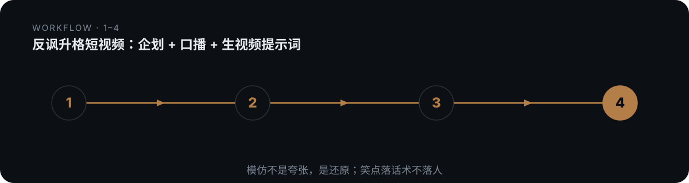

# domn-film-ironic-upgrade


> 把「把廉价日常物拍成买不起的样子」这类反讽升格短视频，做成可直接开拍的企划＋逐句冷面口播＋七段式生视频提示词。

## 真实产出样例

下面是这个技能**实际会产出**的东西（抽自仓库内的 references/ 真实交付样例），不是抽象描述：

```text
笑点零件（拖鞋×爱马仕，逐条真实可还原）：
· 定调口癖：「如何把广东省鞋拍成买不起的样子。」（14字反差开场）
· 递进三段(P1)：「毕竟一旦名字带马、logo 里有马，或者干脆创始人姓马，这样的品牌就自带高端属性。」（三步平行，一步比一步离谱）
· 道具升格＋自我揭短(P2)：「如果预算允许，最好再加一匹不知道哪里来的白马。」
· 元评论(P3)：「每个镜头看起来都有深意，连在一起又谁也说不清意义。这就对了。」
· 谐音收口(P4)：托马仕 ＝ 拖鞋的"托"＋爱马仕的"马/仕"＋玄学词"势"（焊死物与壳）
```

## 是什么

把「把廉价日常物拍成买不起的样子」这类反讽升格短视频，做成可直接开拍的企划＋逐句冷面口播＋七段式生视频提示词。 本仓库是一个 Agent 技能（SKILL.md 为唯一权威定义），把上面的方法论沉淀为可被对话触发的可执行流程。

## 为什么不同

核心动作是「复述」——把目标话语体系的真实套路逐条拆准(一条不许编)，用冷面说明书语气原样还原，笑点自己长出来；区分「样片表皮不继承、话语体系可换、五层骨架必继承」三层。

## 怎么做（工作流）

<p align="center">
  
</p>

> 真实套路逐条拆准；笑点自己长出来

1. **定配方** — [国民级廉价物] × [装X话语体系] 两变量按判据挑
2. **拆套路** — 场地/人物/动作/道具/品牌/文案/姿态/空镜/升华九条目须真实
3. **排零件** — 递进三段/元评论/谐音收口三件必选，其余按需
4. **写文案** — 冷面、精准、递进、不刻薄、平民立场；五件招牌口癖必留
5. **配画面** — 每镜对应一句文案，反差场地/从容停顿/字幕卡硬切
6. **过自检** — 反差/套路真实/递进/元评论/焊死/立场/不破功逐项查
7. **生成提示词** — 七段式，继承骨架不继承皮肤

## 怎么用

将本仓库放入支持 `SKILL.md` 的 Agent 技能目录：

- **WorkBuddy**：`~/.workbuddy/skills/domn-film-ironic-upgrade/`
- **Codex / 其他**：对应 skills 目录

然后在对话中触发，例如：

```
用 domn-film-ironic-upgrade 做一个'拖鞋×爱马仕'反讽升格短视频企划。
```

## 依赖

纯提示词方法论 + references/ 弹药库；生视频依赖文生视频模型（即梦 Seedance / Kling / 可灵等），提示词喂给这些模型执行。

## 仓库结构

```
domn-film-ironic-upgrade/
├── SKILL.md                 # 技能定义（唯一权威）
├── assets/                  # 模板 / 占位素材
├── references/              # 方法论弹药库
└── assets/readme/           # 本 README 的视觉资产（hero.webp / workflow.svg）
```

## 许可

本仓库内容以 `SKILL.md` 为唯一权威定义。如附带 `LICENSE` 文件，以其为准。

---

*README 由 `beautify-github-readme` 生成 · 封面图来自作者作品集，强调色由封面采样派生；工作流图为每技能独立 motif。*